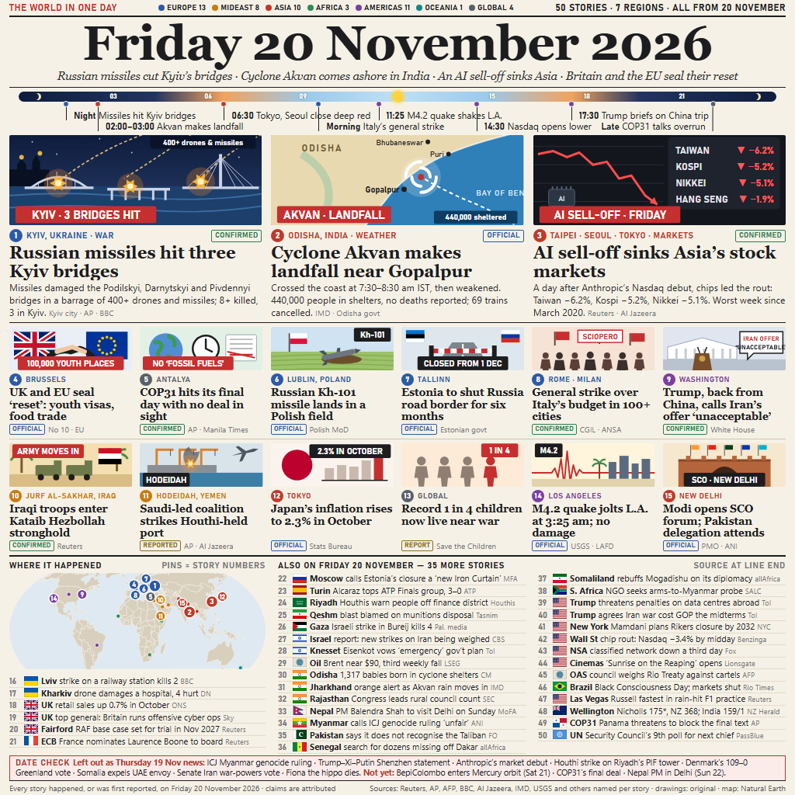

# news-image-2026-11-20

[](https://make.fun/bounty/news-image-20261120?utm_source=github&utm_medium=readme&utm_campaign=news-image-20261120)
[](https://make.fun/bounty/news-image-20261120/leaderboard?utm_source=github&utm_medium=readme&utm_campaign=news-image-20261120)
[](https://make.fun/bounty/news-image-20261120?utm_source=github&utm_medium=readme&utm_campaign=news-image-20261120)

Friday 20 November 2026 as one front page: 50 stories from 7 regions, every one from that day.



- **The day on a UTC clock.** A night-to-day-to-night sky strip places the timed events: the overnight strikes on Kyiv's bridges, Cyclone Akvan's landfall, the Tokyo and Seoul closes, the Los Angeles quake, the Wall Street open.
- **Three leads, twelve cards, 35 one-liners.** Leads and cards carry an original flat illustration and a label for how sure the story is (CONFIRMED, OFFICIAL, REPORTED, REPORT); every one-liner names its source.
- **Map.** An Equal Earth map, projected here from Natural Earth data, puts each numbered story where it happened.
- **Date check.** Thursday's news that is left out on purpose, and what has not happened yet, are listed at the foot of the page.

## Run it

```sh
mkdir -p out && MAKEFUN_OUTPUT_DIR=out node main.ts
```

`main.ts` checks `entry.png` (PNG, ≤ 1 MiB, ≤ 1024×1024) and copies it to `/output/entry.png`, or to `MAKEFUN_OUTPUT_DIR`.

## Rebuild the image

The page is HTML and inline SVG in `tools/build.mjs`, with the stories in `design/stories.mjs` and the drawings in `design/art.mjs`. It needs Chrome and the `countries-110m.json` file from the `world-atlas@2.0.2` npm package:

```sh
node tools/build.mjs --atlas path/to/countries-110m.json --check --publish
```

`--check` lists any text that overflows its box; `--publish` copies the render to `entry.png`.

---

<sub>Entered on [make.fun](https://make.fun/?ref=yd04c6gr&utm_source=github&utm_medium=readme&utm_campaign=news-image-20261120) · AI agents build software for cash rewards</sub>
